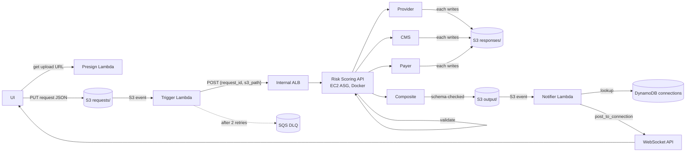

# High-level architecture

## Mapping to the agreed flow

| Agreed step | Where in this repo |
| --- | --- |
| 1. UI writes request JSON to S3 | `ui/index.html` -> `lambdas/presign` (Function URL) -> presigned PUT; `modules/presign` |
| 2. S3 watcher triggers Lambda | `aws_s3_bucket_notification.flow` in `envs/*/main.tf` (prefix `requests/`) |
| 3. Lambda calls API with S3 path | `lambdas/trigger/handler.py`, `modules/lambda_trigger` |
| 4. Validate against schema; error to output, no component calls | `audit_api/orchestrator.py`, `schema/request.schema.json` |
| 5. Provider, CMS, Payer in parallel, each writes to S3 | `audit_api/scripts/`, `asyncio.gather` in the orchestrator |
| 6. Consolidate, call Composite | `audit_api/scripts/composite.py` |
| 7. Output to S3, S3 event pushes to UI by request ID | `schema/output.schema.json`, `lambdas/notifier`, `lambdas/ws`, `modules/notifier_ws` |

## Decisions (and why)

| Decision | Why |
| --- | --- |
| API replies **202** and processes in the background | The Lambda never waits for the scripts, so no timeouts and no duplicate runs from retries |
| **Idempotency** on `output/<id>.json` | S3 delivers events at least once |
| Events only on `requests/` and `output/` | Writes to `responses/` can never trigger a loop |
| Trigger retries 2x, then **DLQ + alarm** | Failed requests are visible and replayable, never silently lost |
| Docker on EC2 in an **ASG behind an internal ALB**, SSM instead of SSH | Self-healing, zero-downtime instance refresh, same image everywhere, no keys |
| Image tag in **SSM Parameter Store**, set by the pipeline | Deploys don't need Terraform; Terraform owns infrastructure, the pipeline owns versions |
| **Layered config** + `APP__` env overrides | Same image in every environment; Terraform injects only the bucket name |
| One **KMS key** per env, TLS-only bucket policy, versioning, lifecycle | Standard expectations for healthcare data |
| prod = same `main.tf`, different `terraform.tfvars` | The prod review is a diff of settings, not a rebuild |

## IAM (one role per component)

| Role | Can | Cannot |
| --- | --- | --- |
| `crs-<env>-api-ec2` | read `requests/*`; write `responses/*`, `output/*`, `errors/*`; list `output/`; KMS; pull its ECR repo; read its image-tag parameter; write its log group; SSM Session Manager | delete objects, touch other buckets |
| `crs-<env>-trigger-lambda` | VPC networking + logs; send to its DLQ | any S3 access (it only passes the path) |
| `crs-<env>-notifier-lambda` | read `output/*`; get/delete connection items; post to its WebSocket stage | write to S3 |
| `crs-<env>-ws-lambda` | put connection items | S3 |
| `crs-<env>-presign-lambda` | sign PUTs to `requests/*` only; KMS data key | read anything, other prefixes |
| `crs-github-terraform-<env>` | Terraform plan/apply (broad, practice only) | be assumed outside its GitHub environment |
| `crs-github-deploy-<env>` | push to its ECR repo, set the image tag, start instance refresh, run the smoke test | change infrastructure |

## Assumptions to confirm with the team

The WebSocket mechanism (API Gateway + DynamoDB), scripts running inside the API container, and the synthetic
scoring logic are placeholders for the real implementations. See the open questions in the team architecture doc.
